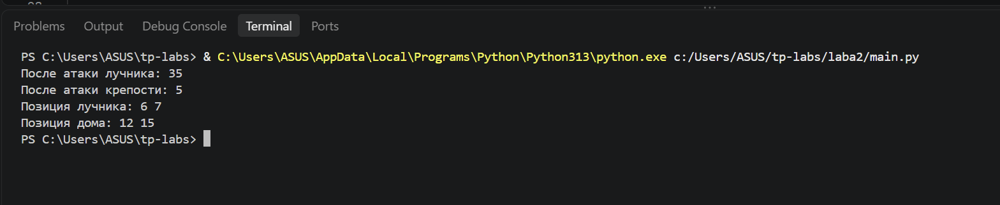

# Лабораторная работа №2. Основы ООП

**Дисциплина:** Технологии программирования  
**Выполнила:** Хужамова Тасмина  
**Группа:** БИВТ-25-4-6  
**Преподаватель:** Пискунов С. А.

## Цель работы

Изучить основные принципы объектно-ориентированного программирования: наследование, инкапсуляцию, абстракцию и полиморфизм. Реализовать иерархию классов для простой пошаговой стратегии.

## Задание

На языке Python реализовать классы игровых объектов:

- `GameObject` — базовый игровой объект;
- `Unit` — юнит, имеющий здоровье;
- `Building` — постройка;
- `Archer` — лучник;
- `Fort` — крепость;
- `MobileHouse` — передвижной дом.

Также реализовать два интерфейса: `Attacker` для атаки и `Moveable` для перемещения объектов.

## Ход работы

### 1. Создание базового класса GameObject

Создан класс `GameObject`, содержащий идентификатор, название и координаты игрового объекта.

Для получения данных реализованы методы `getId()`, `getName()`, `getX()` и `getY()`.

### 2. Реализация классов Unit и Building

Класс `Unit` наследуется от `GameObject` и дополнительно содержит здоровье (`hp`) и состояние жизни (`alive`).

Метод `receiveDamage()` уменьшает здоровье юнита. Если здоровье становится меньше или равно нулю, юнит считается погибшим.

Класс `Building` также наследуется от `GameObject`. Метод `isBuilt()` позволяет проверить состояние постройки, а `setBuilt()` — изменить его.

### 3. Создание интерфейсов

С помощью модуля `abc` реализованы абстрактные классы `Attacker` и `Moveable`.

Интерфейс `Attacker` требует реализации метода `attack()`, а `Moveable` — метода `move()`.

### 4. Реализация конкретных игровых объектов

Созданы три класса:

- `Fort` наследуется от `Building` и реализует `Attacker`. При атаке наносит 30 единиц урона.
- `MobileHouse` наследуется от `Building` и реализует `Moveable`. Может изменять свои координаты.
- `Archer` наследуется от `Unit` и реализует оба интерфейса. Может передвигаться и наносить 15 единиц урона.

Таким образом, в программе использованы наследование классов, абстрактные методы и изменение состояния объектов.

### 5. Проверка работы программы

Для проверки созданы объекты лучника, противника, крепости и передвижного дома.

Лучник атакует противника, после чего крепость наносит дополнительный урон. Затем лучник и дом перемещаются на новые координаты.

Результат выполнения программы:

```text
После атаки лучника: 35
После атаки крепости: 5
Позиция лучника: 6 7
Позиция дома: 12 15
```

Скриншот выполнения программы:



Результаты соответствуют ожидаемым значениям.
Атака, получение урона и перемещение объектов работают корректно.

Полный исходный код программы находится в файле [main.py](main.py).

## Вывод

В ходе лабораторной работы была реализована иерархия классов для пошаговой стратегии на языке Python. Были применены основные принципы ООП, созданы абстрактные классы и реализованы методы атаки, получения урона и перемещения. Работоспособность программы проверена тестовым запуском.
